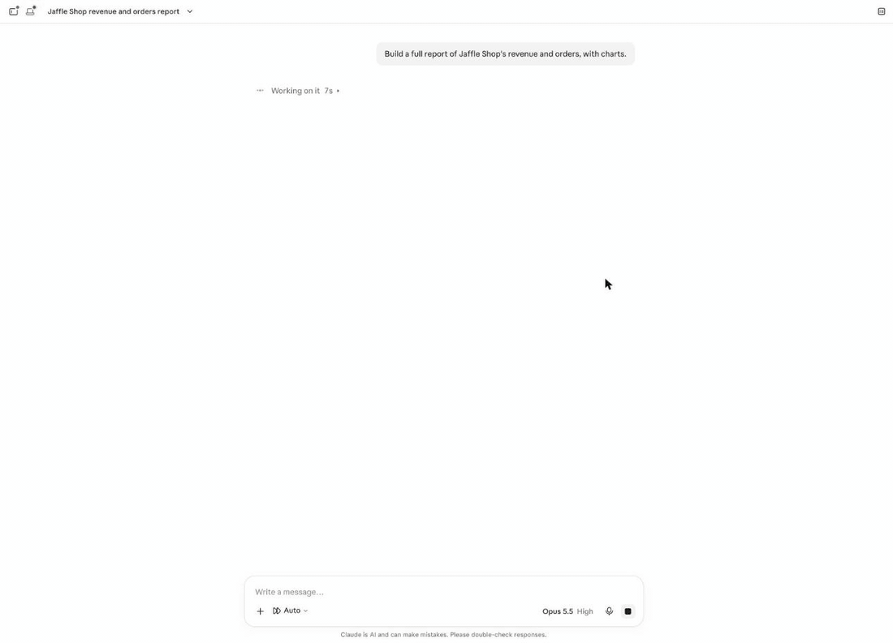

# Kizaru - Open-source MCP server for Lightdash

[](LICENSE)
[](pyproject.toml)
[](https://modelcontextprotocol.io)
[](https://github.com/ntrossat/kizaru-mcp/actions/workflows/ci.yml)
[](https://github.com/astral-sh/ruff)

**Kizaru is an open-source [MCP](https://modelcontextprotocol.io) server for self-hosted [Lightdash](https://www.lightdash.com), with per-user sign-in.**

Query your Lightdash data, and manage its access, content and deliveries, from any AI assistant with your Lightdash permissions.

Works with Claude, ChatGPT, Claude Code and any MCP client that supports OAuth.



## What you can ask

- "What was our revenue by country last quarter?"
- "Who can see the Finance space, and why?"
- "Which dashboards has nobody opened in 90 days?"
- "Pause the weekly sales delivery."

## Features

- **Data:** list explores and their dimensions and metrics, and run queries with filters, sorts and a row limit.
- **Access:** list users, groups and roles. See who can reach a project or a space and why. Grant, change and revoke project access, and manage group membership.
- **Content:** find charts and dashboards nobody views, list validation errors, move and delete content.
- **Deliveries:** list scheduled deliveries with their latest run, pause, edit and delete them.

See [all tools](docs/tools.md).

## Principles

- **Acts as you.** Users sign in with Lightdash. Every call runs with their own role, so the assistant can never do more than they can.
- **Safe by default.** Deletions only preview what they would remove until confirmed, and your client asks before running them.
- **Private tokens.** Lightdash tokens never leave the server.

## Quick start

### Try it on a local Lightdash

Needs Docker and [uv](https://docs.astral.sh/uv/).

1. Clone the repository and start Lightdash with demo data on http://localhost:8080. The MCP server stops at first, asking for its settings.

   ```bash
   git clone https://github.com/ntrossat/kizaru-mcp && cd kizaru-mcp
   cp .env.example .env
   make dev
   ```

2. Register an OAuth client with the local Lightdash, and copy its `client_id` and `client_secret` into `LIGHTDASH_CLIENT_ID` and `LIGHTDASH_CLIENT_SECRET` in `.env`:

   ```bash
   curl -X POST http://localhost:8080/api/v1/oauth/register \
     -H 'Content-Type: application/json' \
     -d '{"client_name":"kizaru-mcp","redirect_uris":["http://localhost:8000/oauth/lightdash/callback"],"scope":"read write"}'
   ```

3. Generate a key and copy it into `FERNET_KEY` in `.env`:

   ```bash
   uv run python -c "from cryptography.fernet import Fernet; print(Fernet.generate_key().decode())"
   ```

4. Run `make dev` again. The MCP server is now on http://localhost:8000/mcp.

5. Add it to your MCP client, then sign in as `demo@lightdash.com` with `demo_password!`:

   ```bash
   claude mcp add --transport http lightdash http://localhost:8000/mcp
   ```

### Run it on your Lightdash

Needs Python 3.15+, uv, Redis, and a Lightdash instance (tested on 3.93.6). Its OAuth server is part of open-source Lightdash.

1. Register an OAuth client with your Lightdash, as in [Configuration](docs/configuration.md#register-an-oauth-client-with-lightdash).
2. Clone the repository, fill in `.env` (your Lightdash URL, the OAuth client and a `FERNET_KEY`), and start the server:

   ```bash
   git clone https://github.com/ntrossat/kizaru-mcp && cd kizaru-mcp
   cp .env.example .env
   uv sync
   uv run kizaru-mcp
   ```

Web clients such as ChatGPT or Claude on the web can't reach `localhost`. Give the server a public HTTPS address, as in [Behind a proxy or a tunnel](docs/configuration.md#behind-a-proxy-or-a-tunnel).

## Documentation

- [Configuration](docs/configuration.md): run the server and connect clients
- [Tools](docs/tools.md): every tool and the Lightdash API it calls
- [Architecture](docs/architecture.md): sign-in, tokens, storage and errors
- [Development](docs/development.md): local Lightdash, make targets and tests

## Contributing

Issues and pull requests are welcome. Run `make lint` and `make test` before opening a pull request, and update `docs/` in the same change as the code.

## Security

Report vulnerabilities privately, as in [SECURITY.md](SECURITY.md).

## License

[MIT](LICENSE)
