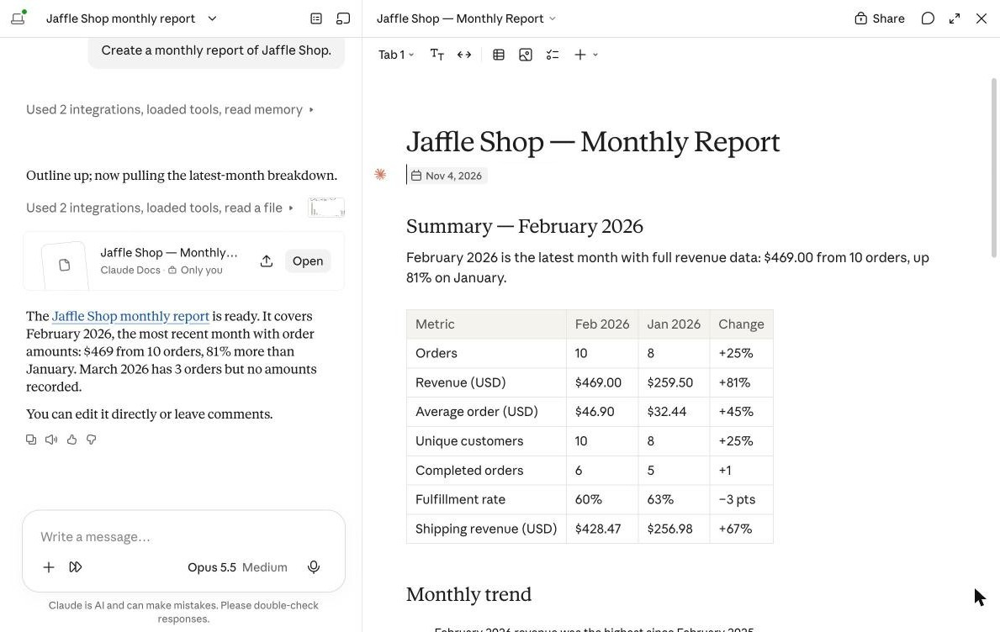
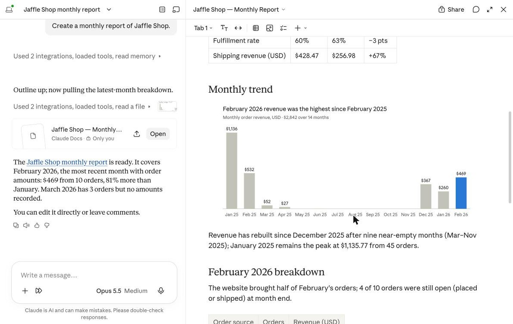
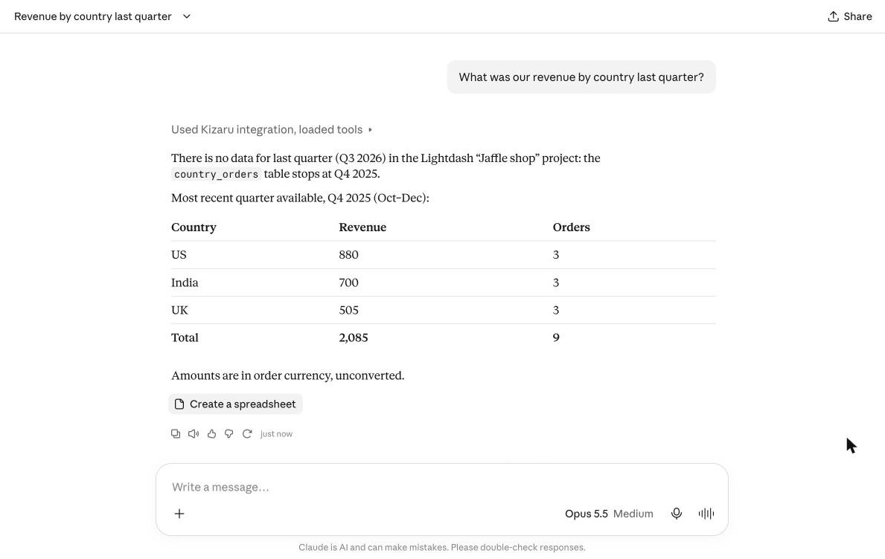
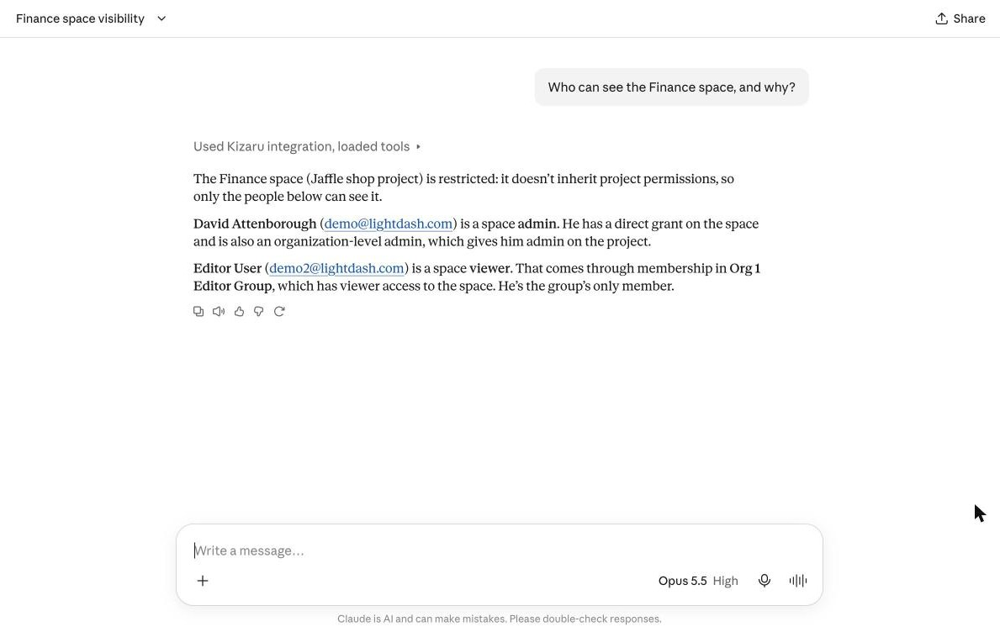
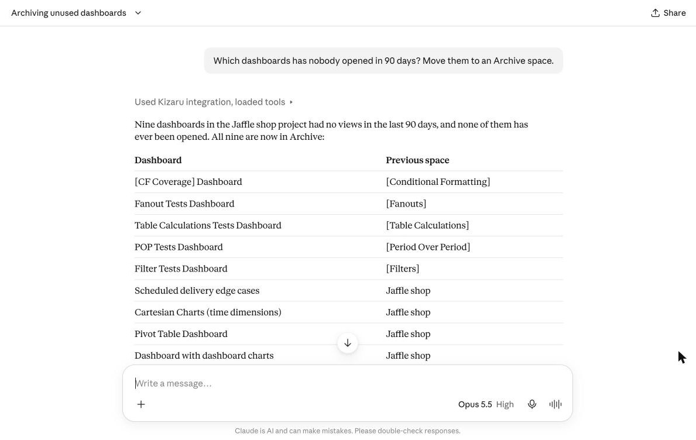
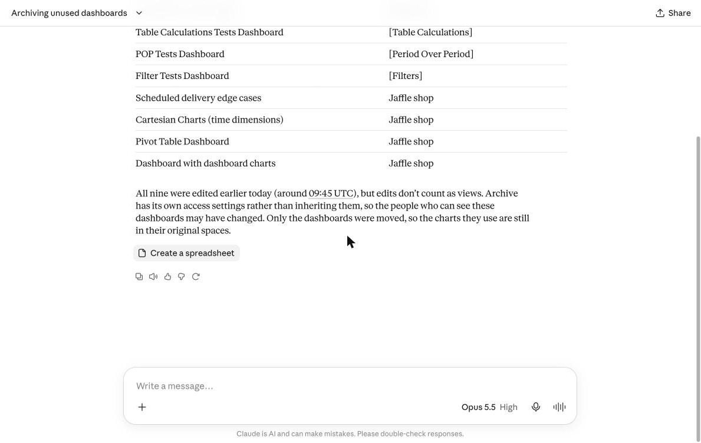
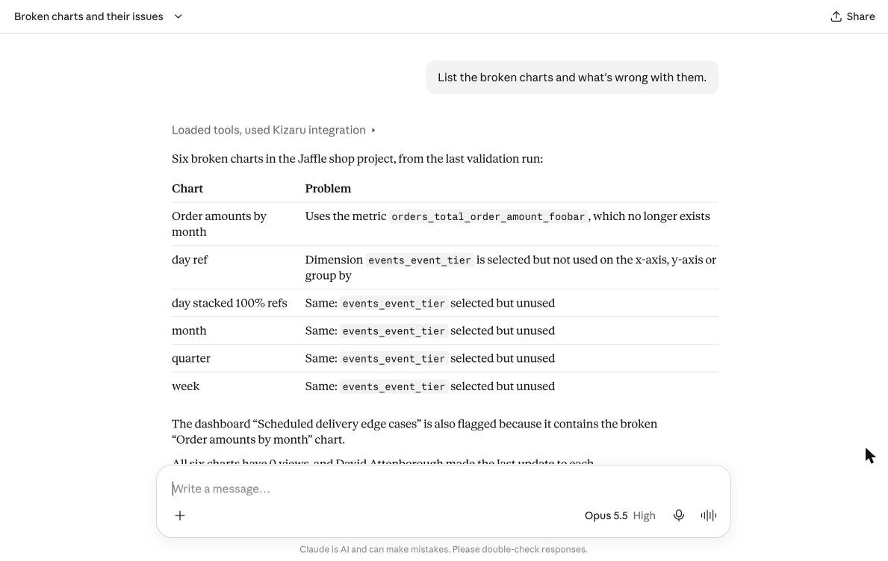
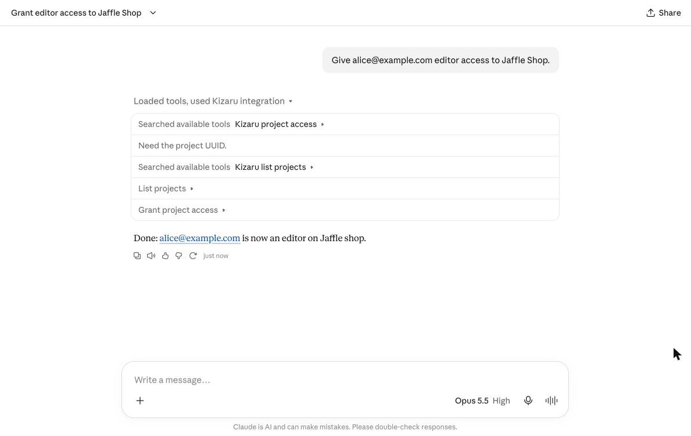
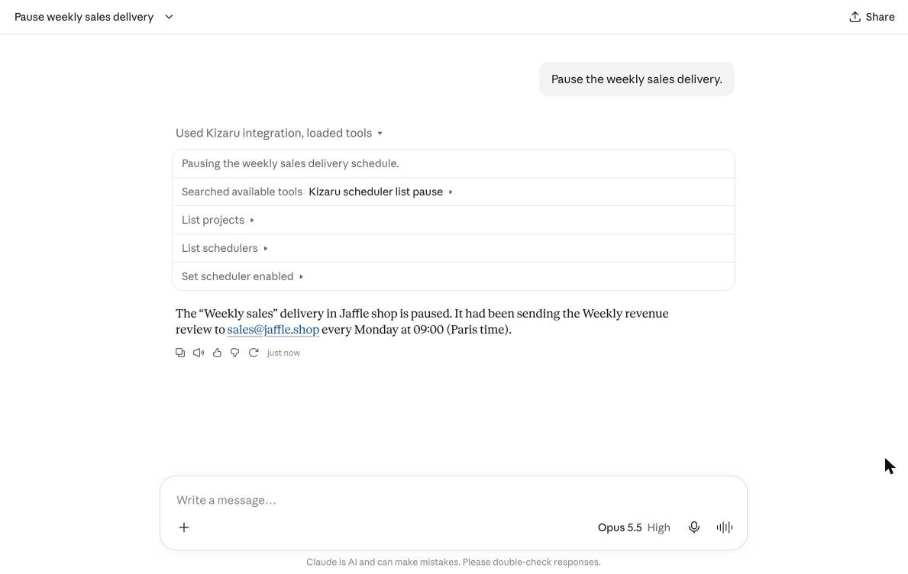

# Use cases

What you can ask once Kizaru is connected. Screenshots from Claude.ai on the local Lightdash demo (`make dev`).

## Monthly report

> Create a monthly report of Jaffle Shop.

Tools: `list_projects`, `list_explores`, `get_explore`, `run_query`

## Revenue by country

> What was our revenue by country last quarter?

Tools: `list_projects`, `list_explores`, `get_explore`, `run_query`

## Space access

> Who can see the Finance space, and why?

Tools: `list_projects`, `list_spaces`, `list_space_access`, `list_groups`

## Unused dashboards

> Which dashboards has nobody opened in 90 days? Move them to an Archive space.

Tools: `list_projects`, `find_unused_content`, `list_spaces`, `move_content`

## Broken charts

> List the broken charts and what's wrong with them.

Tools: `list_projects`, `list_validation_errors`

## Project access

> Give alice@example.com editor access to Jaffle Shop.

Tools: `list_projects`, `grant_project_access`

## Deliveries

> Pause the weekly sales delivery.

Tools: `list_projects`, `list_schedulers`, `set_scheduler_enabled`

